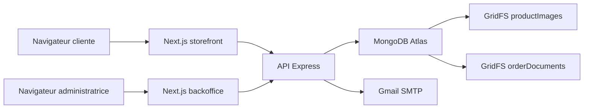

# Architecture de Tata Lulu Shop

## Vue d'ensemble

Tata Lulu Shop est une application e-commerce légère composée de deux
applications TypeScript :

- `lulu_shop_front` : interface publique et backoffice avec Next.js App Router
- `backend-lulu` : API REST Express connectée à MongoDB Atlas

L'ancien site statique (`index.html`, `script.js`, `style.css`) reste à la
racine comme référence visuelle. Il n'est pas utilisé par la nouvelle
application.



Les bons de commande sont générés côté Express avec PDFKit après la transaction
de confirmation. Le binaire reste dans GridFS `orderDocuments`, tandis que la
commande ne conserve que son numéro, l'identifiant du fichier et sa date de
génération. Le compteur quotidien est isolé dans
`orderdocumentsequences` pour garantir l'unicité en cas de confirmations
concurrentes.

## Frontend

Le frontend suit une séparation inspirée de la Clean Architecture :

```text
lulu_shop_front/src/
├── app/                       # Routes Next.js, metadata et feuilles globales
├── core/
│   ├── domain/
│   │   ├── models/            # Types métier
│   │   ├── repositories/      # Contrats d'accès aux données
│   │   └── use-cases/         # Cas d'utilisation
│   └── infrastructure/
│       ├── datasources/       # Appels vers l'API Express
│       ├── dtos/              # Conversion API vers domaine
│       ├── http/              # Client Axios
│       └── repositories/      # Implémentations des contrats
├── lib/
│   ├── container.ts           # Composition root : câble datasource et repositories
│   └── …                      # Helpers et données de repli
├── presentation/
│   ├── components/admin/      # Backoffice
│   ├── components/storefront/ # Boutique publique
│   ├── components/ui/         # Composants génériques
│   └── providers/             # Panier et état transversal
└── services/                  # Façades du backoffice, au-dessus des repositories
```

Règle de dépendance : `LuluShopApiDatasource` n'est instancié que dans
`lib/container.ts` et n'est référencé que par les implémentations de
`core/infrastructure/repositories`. Les façades de `services/` et les composants
de `presentation/` ne connaissent que les interfaces de
`core/domain/repositories` — jamais le transport HTTP.

Un composant réutilisable reçoit son repository en prop optionnelle, avec pour
valeur par défaut celle du composition root (voir `Storefront`). Les points
d'entrée du framework (`app/sitemap.ts`, `lib/load-storefront-data.ts`)
importent directement le container : c'est leur rôle de câblage.

### Routes frontend

| Route | Rôle |
| --- | --- |
| `/` | Accueil et sélection de produits |
| `/produits` | Catalogue, filtres et pagination |
| `/produits/[slug]` | Détail d'un produit |
| `/a-propos` | Présentation de la boutique |
| `/admin` | Connexion et backoffice |
| `/panier` | Route historique conservée ; le panier principal est un tiroir |
| Toute URL inconnue | Page 404 générée par Next.js |

La frontière `error.tsx` affiche la page 500 et `not-found.tsx` affiche la
page 404. Ces écrans ne dépendent pas de l'API.

Aucune route ne fait échouer le build quand l'API est éteinte : les pages
publiques passent par `loadStorefrontData` (repli sur `fallbackStoreContent` et
un catalogue vide) et `app/sitemap.ts` publie ses pages statiques sans les
fiches produits. Un `next build` réussi ne prouve donc pas que l'API répond.

### Chargement et images

- `next/image` génère des variantes AVIF/WebP adaptées à l'écran.
- Le hero et l'image principale d'une fiche sont prioritaires.
- Les images du catalogue hors écran, les miniatures et la carte Google Maps
  sont chargées en différé.
- Le catalogue affiche neuf cartes par page tout en conservant les filtres
  instantanés côté navigateur.
- Les modules lourds du backoffice sont chargés dynamiquement à l'ouverture de
  leur écran.

## Backend

Chaque domaine métier possède son dossier dans `backend-lulu/src/modules`.

```text
backend-lulu/src/
├── app.ts                     # Montage des routes et middlewares
├── server.ts                  # Connexion MongoDB et démarrage
├── config/                    # Environnement et base de données
├── middlewares/               # JWT, validation, erreurs et logs HTTP
├── modules/
│   ├── auth/
│   ├── admin-notifications/
│   ├── audit/
│   ├── backups/
│   ├── contact-requests/
│   ├── customers/
│   ├── dashboard/
│   ├── monitoring/
│   ├── notifications/
│   ├── orders/
│   ├── products/
│   ├── stock-movements/
│   ├── store/
│   └── uploads/
├── scripts/                   # Seed, restauration et contrôles automatisés
└── utils/                     # AppError, logger et erreurs processus
```

Dans un module, la route appelle le contrôleur, le contrôleur appelle le
service, puis le service utilise le modèle Mongoose. Les entrées sont validées
avec Zod avant le contrôleur.

Les services qui diffusent un fichier (sauvegardes, bons de commande, images)
ne dépendent pas d'Express : ils reçoivent un `HttpStreamTarget` ou un
`HttpDownloadTarget` (`src/utils/http-download-target.ts`). `express.Response`
satisfait ces contrats structurellement, ce qui rend ces services testables
avec un simple `PassThrough`.

## Flux métier principaux

### Commande

1. Le panier envoie les slugs, couleurs, tailles et quantités à
   `POST /api/orders`.
2. L'API relit les produits et les prix depuis MongoDB ; elle ne fait pas
   confiance aux prix envoyés par le navigateur.
3. Une commande `pending` est créée avec une référence `TL-AAAAMMJJ-XXXXXX`.
4. La création ne retire pas encore le stock.
5. La confirmation admin passe la commande à `confirmed` et retire le stock de
   la combinaison couleur et taille dans une transaction MongoDB.
6. L'annulation restaure exactement la même combinaison si le stock avait été
   engagé.
7. La finalisation passe la commande à `completed`.
8. Une commande en attente trop longtemps devient `expired`.

Les articles ajoutés manuellement dans le backoffice restent possibles. Ils
n'ont pas de relation obligatoire avec un produit du catalogue.

### Images produit

1. L'administratrice envoie un fichier à `POST /api/admin/uploads`.
2. Le backend valide le type et la taille, puis l'enregistre dans GridFS.
3. L'API retourne `/api/uploads/:id`.
4. Le frontend utilise cette URL dans les variantes produit.
5. La lecture publique répond avec un cache immuable et un `ETag`.

### Démarrage backend

Après la connexion Atlas, le backend exécute une seule fois les migrations de
compatibilité des anciens produits, tailles, commandes et mouvements de stock,
synchronise les profils clientes et le centre de notifications, puis vérifie
les index. Il lance ensuite les tâches
d'expiration des commandes, de reprise des e-mails, de nettoyage GridFS et de
rétention quotidienne des notifications.

Les lectures clientes, commandes et notifications ne rejouent pas ces
synchronisations. Les profils et alertes sont remis à jour après les mutations
concernées et au démarrage. L'expiration des commandes est contrôlée toutes les
15 minutes, pas à chaque consultation du backoffice.

### Chargement du backoffice

Après authentification, le frontend charge uniquement les statistiques du
tableau de bord et le résumé des notifications. Les produits sont chargés à
l'ouverture du catalogue, de l'éditeur ou des commandes. La liste des
commandes est recherchée, filtrée et paginée par l'API, avec huit lignes par
page. Cette séparation évite de télécharger tout l'historique à la connexion.

## Authentification

Il n'existe pas de collection `users`. Le compte administrateur provient de
`ADMIN_EMAIL` et `ADMIN_PASSWORD`. Une connexion valide retourne un JWT signé
avec `JWT_SECRET`, valable 12 heures. Toutes les routes `/api/admin/*` exigent :

```http
Authorization: Bearer <token>
```

Cette architecture convient à un seul compte administrateur. Une gestion
multi-utilisateur nécessiterait un vrai modèle utilisateur, des mots de passe
hachés et une gestion des rôles ; elle n'est pas implémentée.
